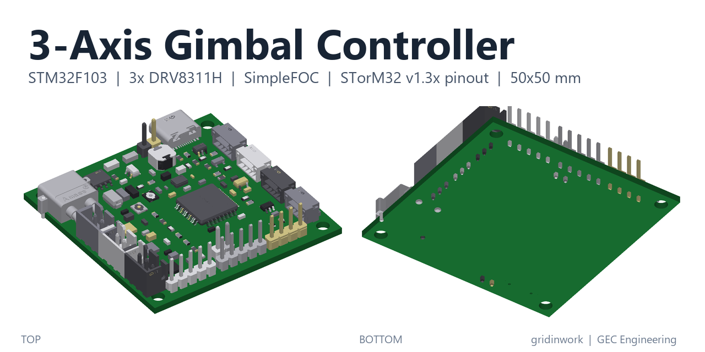
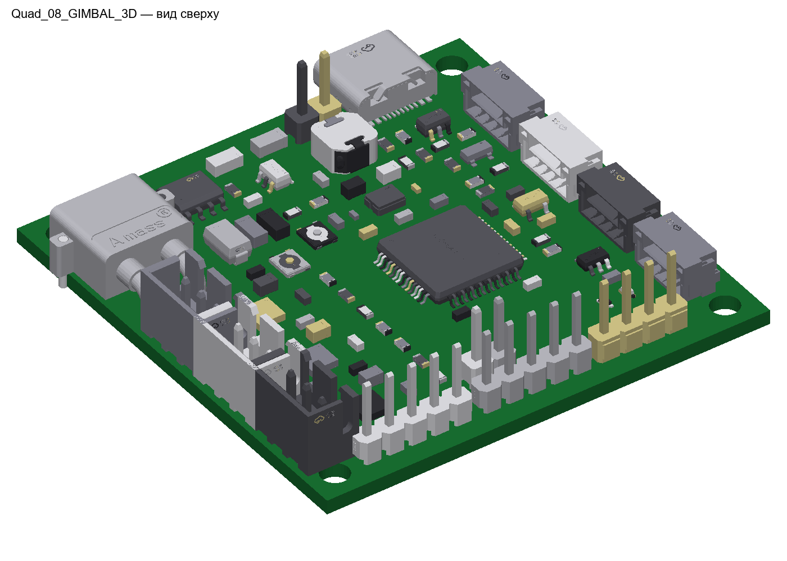
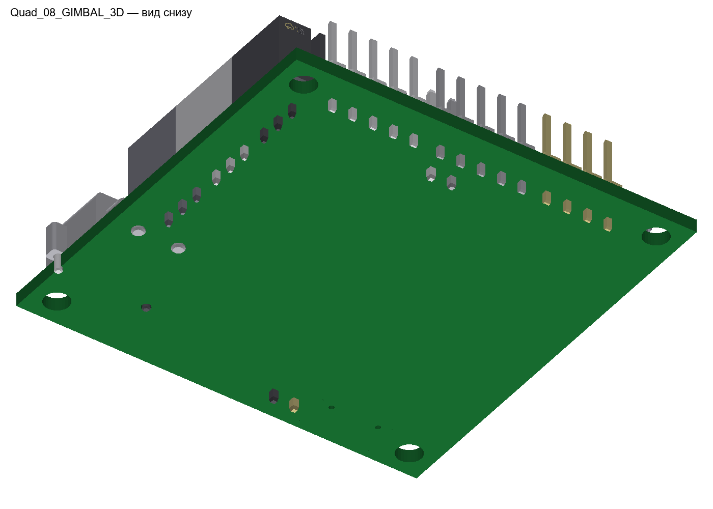
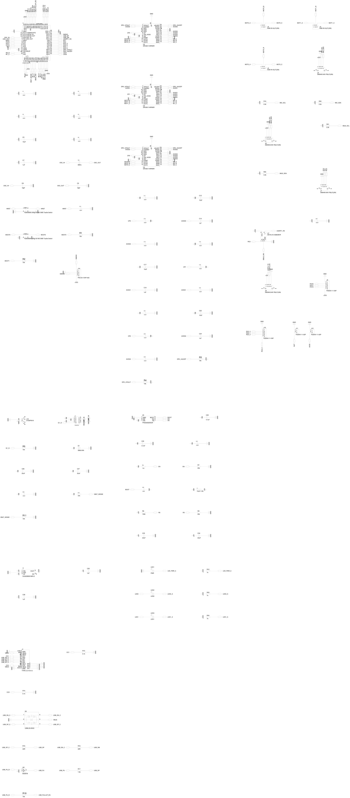
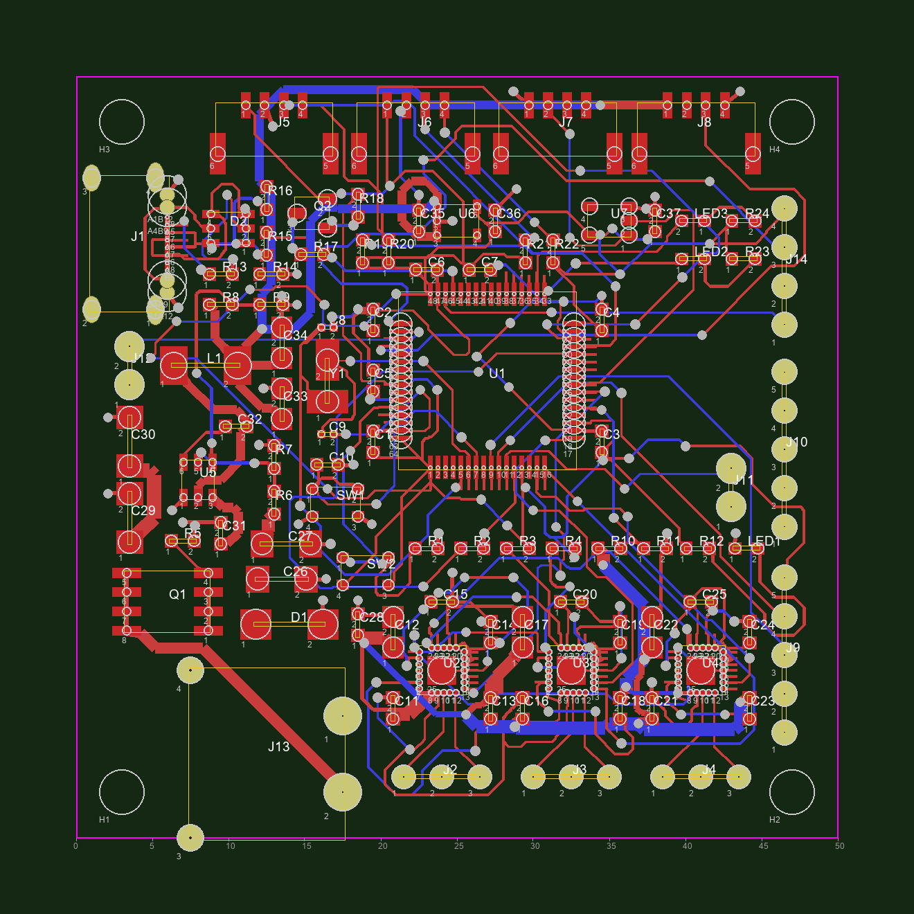

# STM32 3-Axis Gimbal Controller (DRV8311 + SimpleFOC)

DIY controller for a **3-axis brushless camera gimbal**, **pin-compatible with the STorM32 BGC v1.3x** (the most common 3-axis gimbal controller). STM32F103RCT6 drives three **DRV8311H** motor drivers in 3xPWM mode; the IMU is an external **MPU-6050 (GY-521) module** on a cable. Power input 2S-4S (the drivers allow 20 V max). **50 x 50 mm**, 2-layer PCB.

## Highlights

| Block | Part |
|---|---|
| MCU | STM32F103RCT6, 72 MHz, 256 KB / 48 KB |
| Motor drivers | 3 x DRV8311HRRWR (3-20 V, 5 A peak, built-in current sense), INLx tied to AVDD, common nSLEEP (PB14) / nFAULT (PB15) |
| Power | VBAT -> AO4407A reverse-polarity P-FET -> SMAJ18A TVS; TPS54202 buck to 5 V; XC6220 3.3 V LDO |
| IMU | GY-521 module (MPU-6050) on I2C2 (PB10/PB11), JST-GH; no magnetometer, yaw comes from the gyro |
| USB | USB-C + USBLC6, D+ pull-up switched by PB5 |
| Misc | SN74LVC1G86 XOR as S.Bus inverter, JST-XH motor connectors, RC / AUX / SWD headers |

## Status (work in progress)

- Schematic complete (93 components, 79 nets); PCB placed, **routing is not finished** (some nets must be routed by hand), copper pours and DRC not done.
- Pin map was extracted from the open STorM32 v1.30 schematic and cross-checked with the SimpleFOC community; the design itself is new (DRV8311H instead of DRV8313/TC4452 because DRV8313 is not stocked at LCSC).
- Firmware v0.1.0 builds; the board has not been manufactured and nothing has been tested on hardware.

## Gallery

| 3D (top) | 3D (bottom) |
|---|---|
|  |  |

| Schematic | PCB layout (current state) |
|---|---|
|  |  |

## Repository layout

| Path | Content |
|---|---|
| `hardware/EasyEDA/` | EasyEDA Pro project (`.epro2`), schematic and PCB PDF/PNG, 3D STEP model with components, netlist, BOM and CPL (JLCPCB format) |
| `images/` | 3D renders (top/bottom), schematic and PCB previews |
| `docs/` | Design documentation: requirements, pin map, BOM notes, full board description (**written in Russian**) |
| `firmware/` | Own SimpleFOC-based firmware `GEC-BGC` (source + build), reference pin map of STorM32 v1.3x |

## How to open the design

1. Install [EasyEDA Pro](https://pro.easyeda.com/) (free).
2. *File -> Import -> EasyEDA Pro* and select `hardware/EasyEDA/Quad_08_GIMBAL.epro2`.
3. The 3D model (`*_3D.step`) opens in any CAD (SolidWorks, Fusion, FreeCAD, Blender with a STEP importer).

## Bill of materials

Parts are chosen from the LCSC/JLCPCB catalogue (LCSC numbers are in `hardware/EasyEDA/*_BOM.xlsx` and `docs/BOM.md`). Stock levels change daily - **re-check availability before ordering**. `*_CPL.xlsx` is the pick-and-place file for JLCPCB assembly.

## License

Hardware (schematic, PCB, 3D model, documentation): **CERN-OHL-P-2.0** (see `LICENSE`).

Firmware sources written for this project: **MIT** (`LICENSE-MIT`). Pre-built binaries of third-party firmware keep the licenses of their projects - see `firmware/README.md`.

Part of the [DIY Quadcopter Hardware](https://github.com/gridinwork/DIY-Quadcopter-Hardware) project by Oleg Gridin, GEC Engineering.
